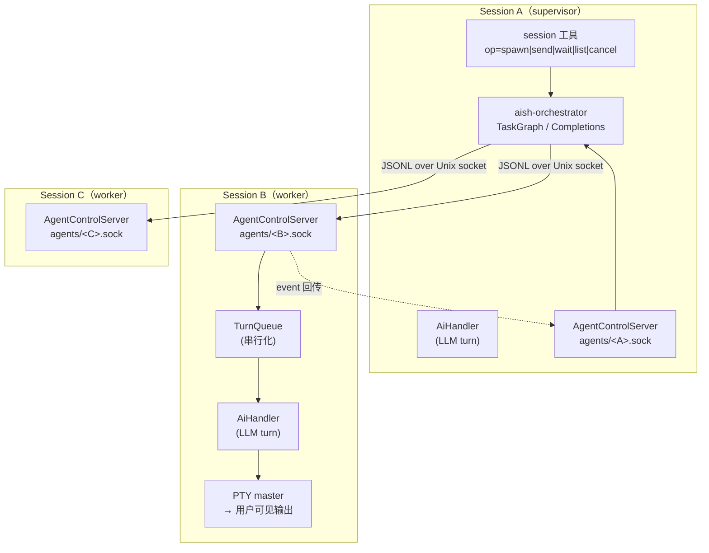

# AISH 编排（Supervisor）架构说明

> 面向使用者和维护者的通俗讲解。读完你就能明白：aish 怎么从"一个有 AI 的
> shell"变成"一个能指挥很多个 shell 做事的调度器"，为什么这样设计，以及哪些
> 东西**刻意没做**。

---

## 1. 一句话概括

**aish 的一个会话可以作为 supervisor，把任务派给其它 aish 会话（或系统上的
omp / opencode 进程）去跑，收集结果、决定下一步；被派活的会话里，用户照常
打字、照常看 AI 流式输出、照常 Ctrl+C 打断。**

一句话拆成三个必须同时成立的约束：

| # | 约束 | 为什么 |
|---|---|---|
| **I1** | 目标会话的用户体验不降级 | 任务注入走的是**同一条** `AiHandler::handle_question` 路径，输出经同一 PTY 广播 |
| **I2** | 任务与用户输入**严格串行** | 同一会话只有一个 turn 锁；不存在"AI 任务插队"或"用户输入被吞" |
| **I3** | 任务来源可见 | transcript 里带 `[supervisor:<uuid8>]` 前缀，面板里能看到"被谁调度" |

这三条不是"尽量满足"，是**设计前提**。任何方案如果做不到，就否掉。

---

## 2. 先搞懂三个角色

### 2.1 Supervisor —— "派活的人"

一个**普通的 aish 会话**，只是它额外持有编排器（`aish-orchestrator`）。
它可以是：

- 你在终端里开的 aish（P1，前台编排）——最常用
- 一个 headless 进程（P3，CI 场景）——`aish supervisor run plan.yaml`

Supervisor 做的事：

- 把任务翻译成 `agent://<session-uuid>[/<agent-id>]` 地址
- 通过 Unix socket 把任务投递给目标会话
- 收集 `settled` 事件，推进 DAG 的下一步
- 在面板里展示所有会话的 agent 状态

Supervisor **不是**：

- 不是新的 daemon 层。PTY daemon 保持"1 daemon = 1 PTY = 1 aish 子进程"
  （`crates/aish-pty/src/daemon.rs:689-710` 的 `child_pid: u32` 是单值）
- 不是终端接管者。不碰 `crossterm` 的 raw mode，不画全屏
- 不是唯一所有者。多个 supervisor 可同时向同一会话派活；**任务**有 owner，
  **会话**没有全局 lease

### 2.2 Worker Session —— "干活的人"

也是普通的 aish 会话。它多了一个东西：**Agent 控制服务端**
（`AgentControlServer`，监听 `agents/<session-uuid>.sock`）。

Worker 做的事：

- 接受 supervisor 的 `prompt` / `cancel` / `history` 请求
- 把任务排进**自己的** turn 队列（与用户输入共享）
- 把 LLM 事件流（`LlmEvent`）回传给 supervisor
- 任务完成后回传 `settled`（含 usage、output_path）

Worker 的用户看到的是：

```text
◆ aish ➜ ; 帮我跑一下测试
  └─ [supervisor:3f2a1b] 帮我跑一下测试        ← 任务来源标记（暗色）
     ● bash cargo test
     ... 流式输出 ...
  ✓ 测试通过（3 passed）                        ← 正常 AI 回复
◆ aish ➜ ▊                                     ← 用户随时可打断
```

**关键**：`Ctrl+C` 用的还是 `self.ai_handler.cancellation_token()`
（`crates/aish-shell/src/app.rs:3765`），和用户手动触发的是**同一个** token。
这不是巧合，是设计——见 §5 D1。

### 2.3 Agent —— "被派出去的执行单元"

一个会话里可以有多个 agent：

| 类型 | 生命周期 | 承载 |
|---|---|---|
| `main` | 会话本身 | `AishShell` 的 `AiHandler` |
| `sub`（`Agent` 工具的产物） | 进程内 `LlmSession` | `create_subsession()`（`crates/aish-llm/src/session.rs:2136`） |
| `external`（P4） | 子进程 | `omp --mode rpc` / `opencode serve` |

三者的区别只在于 **`AgentRuntime`** 枚举：

```rust
pub enum AgentRuntime {
    Native,                                        // in-process LlmSession
    Omp { socket: PathBuf, pid: u32, session_file: PathBuf },
    Opencode { base_url: Url, session_id: String },
}
```

---

## 3. 为什么不能改 PTY 协议（被否决的方案）

在给出设计之前，先说清楚**试过但不走**的路。

### 3.1 方案 A：往 PTY 帧里加 `TYPE_PROMPT`

否决理由：

1. **角色检查会挡住**。`crates/aish-pty/src/daemon.rs:1416` 的
   `TYPE_INPUT` 分支有 `arbiter.role_of(fd) == ClientRoleState::Controller`
   检查——observer 的输入被静默丢弃。supervisor 通常不是 controller。
2. **会污染用户输入行**。往 PTY 写字节等于"替用户打字"，用户正在编辑
   的命令行会被打乱，直接违反 I1。
3. **帧上限不够**。`MAX_FRAME_PAYLOAD = 65535`（`daemon_protocol.rs:17`），
   transcript 增量经常超。
4. **回归面大**。`role_arbitration.rs` 是端到端测试（起 daemon → 两个
   `AttachedBackend` → 断言角色），改协议要动它。

### 3.2 方案 B：daemon 层加请求-响应

否决理由：daemon 是**单线程 `select(50ms)` 循环**（`daemon.rs` 的
`run_pty_daemon_shell`），加同步请求-响应会阻塞 PTY 转发，引入可感知延迟。

### 3.3 方案 C：`process_line` 注入

否决理由：`AishShell::process_line`（`app.rs:3488`）会走 `classify_input`，
把 `;` 前缀当成 AI 意图——但它在**主线程**上跑，而主线程阻塞在
`read_line`（legacy，`app.rs:3299`）或 `reader.read`（v2，`repl.rs:243`）。
没有可插入点。

**结论**：新开一条**独立的** Unix socket，与 PTY 完全解耦。这样：

- `daemon_protocol.rs` 的 16 个 type tag **零改动**
- `role_arbitration.rs` **零回归**
- 协议可以独立演进版本

---

## 4. 架构



### 4.1 进程与文件布局

```text
$XDG_RUNTIME_DIR/aish/
├── pty-<uuid8>.sock                    # 既有：PTY daemon（不改）
└── agents/
    └── <session-uuid>.sock             # 新增：Agent 控制 socket（0600）

~/.local/share/aish/
├── pty-sessions/<uuid>.json            # 既有：会话元数据（不改，只加字段）
└── orchestrator/
    ├── tasks/<task-id>.json            # 新增：任务状态（可恢复）
    └── out/<agent-id>.md               # 新增：agent 产物
```

`agents/` 目录复用 `pty_socket_dir()` 的属主/权限校验
（`daemon.rs:830-863`：非 `/run/user` 时检查 `uid` 与 `mode & 0o077`）。

### 4.2 新增 crate

| crate | 职责 | 为什么独立 |
|---|---|---|
| `aish-orchestrator` | `AgentRegistry` / `AgentJob` / `AgentBus` / `TaskGraph` / `AgentBackend` | 编排有副作用；`aish-supervisor` 必须保持"纯聚合、零副作用"（其 `tasks.rs:1-8` 的模块契约） |
| `aish-engine-omp` | omp RPC 客户端封装 | 依赖 `oh-my-pi/sdk/rust/omp-rpc`（path 依赖） |
| `aish-engine-opencode` | opencode HTTP + SSE 客户端 | 依赖 `reqwest`；可 feature-gate 掉 |

`aish-shell` 需要新增 `aish-supervisor` + `aish-orchestrator` 依赖
（当前 `crates/aish-shell/Cargo.toml` 两者都没有）。

---

## 5. 关键设计决策

### D1 — 任务注入：`Arc<tokio::sync::Mutex<AiHandler>>` + 后台 turn 执行器

**问题**：`AiHandler` 是 `AishShell` 的字段（`app.rs:1067`），`&mut self`
独占。

**决策**：

```rust
// crates/aish-shell/src/agent_exec.rs
pub struct AgentExecutor {
    handler: Arc<tokio::sync::Mutex<AiHandler>>,
    /// One turn at a time per session; supervisor tasks and user input share it.
    turn_lock: tokio::sync::Mutex<()>,
}

impl AgentExecutor {
    pub async fn run_turn(&self, prompt: InjectedPrompt) -> TurnOutcome {
        let _guard = self.turn_lock.lock().await;   // I2：串行化
        let mut h = self.handler.lock().await;
        let result = tokio::select! {
            r = h.handle_question(&prompt.text) => r,
            _ = prompt.cancel.cancelled() => Err(AishError::Cancelled),
        };
        TurnOutcome { result, usage: h.session_token_stats() }
    }
}
```

**为什么是 `tokio::sync::Mutex` 而不是 `parking_lot::Mutex`**：
`handle_question`（`ai_handler.rs:665-760+`）内部 `.await`
（`compact_context_before_send`），持锁跨 await 必须用异步 mutex。建议加
`#![deny(clippy::await_holding_lock)]` 防回归。

**为什么这个改动可接受**：`AishShell` 是单线程驱动的，`ai_handler` 的
41 处调用点（`grep "ai_handler\." app.rs`）都在主线程同步路径里，加
`.lock().await` 是机械改动。它同时解锁了 legacy 与 `AISH_UI=v2` 两条路径
的统一——不需要为 v2 单独做注入。

**正确性论证（I1）**：`handle_question` 是用户手动输入调用的**同一个**
函数。所以：

- `Ctrl+C` 走 `self.ai_handler.cancellation_token()`（`app.rs:3765`）→
  同一个 token → 能中断 supervisor 任务
- 流式输出走 `self.ai_handler.set_event_callback(...)`（`app.rs:2032-2700`）
  → 同一套 `out_line!` 宏 → 同一 PTY 广播
- 消息进 `context_manager` → 同一 transcript

**代码里没有分叉，所以不存在"AI 任务绕过用户"的可能。**

### D2 — 生命周期：九态

omp 只有四态（`running/idle/parked/aborted`，`registry/agent-lifecycle.ts`）。
aish 的 `ToolResult.meta` 已用 `dispatch_status` 表达短接
（`agent_tool.rs:263-272`），必须保留，因此扩到九态：

```
Queued ──permit──▶ Running ──yield──▶ Idle ──TTL──▶ Parked
                      │                  │             │
                      │ fatal            │ release     │ ensure_live
                      ▼                  ▼             ▼
                    Failed           Aborted ◀─────────┘
                      │
                      └─ Ctrl+C ──▶ Cancelled（本轮短接，不写 tombstone）
```

| 状态 | 语义 | 跨重启 | 用户可见 |
|---|---|---|---|
| `Queued` | 等 `turn_lock` 或 semaphore | 否 | 面板显示排队中 |
| `Running` | 正在跑 LLM turn | 是 | 流式输出到 PTY |
| `Idle` | 本轮结束，会话可被唤醒 | 是 | 面板显示 idle |
| `Parked` | TTL 到期，会话释放但 transcript 保留 | 是 | 面板显示 parked |
| `Aborted` | 显式 kill，写 `.tombstone` | **是** | 面板显示 aborted |
| `Cancelled` | 用户 Ctrl+C，本轮短接 | 否 | 打印 `已中断` |
| `Failed` | fatal（provider/parse） | 否 | 打印 `error_category` |
| `Completed` | 正常 yield | 是 | 面板绿色 |
| `Stopped` | 被 supervisor 主动 `cancel` | 是 | 面板显示 stopped |

**单一终结权**：只有 `AgentRegistry` 能写 `Parked ↔ Idle`；执行器只调
`registry.finalize(agent_id, outcome)`。这是 omp
`AgentLifecycleManager` 用 `ParkInFlight` / `RevivingAgent` /
`ReopeningAgent` 三张表换来的教训——并发 park 与 revive 必须合并，
否则会写出竞态。

`Cancelled` 与 `Aborted` **必须分开**：前者只影响当前 turn 的
`ToolResult.meta.dispatch_status="short_circuit"`，后者跨重启存活。

### D3 — 协议：`agents/<uuid>.sock` 上的 JSONL

每行一个 JSON 对象（与 `control.rs` 的 NDJSON 风格一致）：

```jsonc
// supervisor → worker
{"id":"1","op":"list_agents"}
{"id":"2","op":"prompt","agent":"<id>","text":"…","delivery":"queue|steer|interrupt",
 "owner":{"session":"<supervisor-uuid>","task":"<task-id>"},"output_schema":{...}}
{"id":"3","op":"cancel","agent":"<id>","reason":"…"}
{"id":"4","op":"history","agent":"<id>","from_byte":0}
{"id":"5","op":"subscribe","level":"off|progress|events"}
{"id":"6","op":"spawn","agent_type":"explore","task":"…","background":true,
 "engine":"native|omp|opencode","cwd":"/path"}

// worker → supervisor
{"id":"2","ok":true,"result":{"agent":"<id>","state":"queued"}}
{"type":"event","session":"<uuid>","agent":"<id>","event":{...LlmEvent...}}
{"type":"settled","agent":"<id>","outcome":{"state":"completed","text":"…",
 "usage":{...},"output_path":"…"}}
{"id":"1","ok":false,"error":"...","code":"agent_not_found"}
```

**投递语义**（照抄 omp `IrcBus` 的四值，但**失败不入信箱**）：

| 目标状态 | 行为 | 返回 |
|---|---|---|
| 有 `wait` 等待者 | 直接 resolve | `Injected` |
| `Running` | `queue` 等本轮；`steer` 在下一 step 边界注入（P2）；`interrupt` 先 `cancel` 再入队 | `Injected` |
| `Idle` | 起新 turn | `Woken` |
| `Parked`/`Aborted` | 从 transcript 复活再投 | `Revived{generation}` |
| 不存在 | 拒绝 | `Failed{reason}` |

> **与 omp 的有意分歧**：omp 失败入信箱（`MAILBOX_CAP=100` 丢最旧，
> `irc/bus.ts`）。aish 的 daemon 已有 256 KiB scrollback
> （`scrollback.rs:11`），被拒消息由 UI 提示重发即可，避免引入第二条
> 持久化路径。此分歧**必须**写进代码注释。

**为什么不做事件重放**：omp 的 RPC 没有 `after` 游标（`get_entries{since}`
只针对持久历史），断线只能重启进程 + `open_session`。aish 的 transcript 是
append-only 文件，`history{from_byte}` 直接读文件，天然幂等——比维护一个
可续传的事件游标简单得多。

### D4 — 任务模型（DAG）

```rust
// crates/aish-orchestrator/src/task.rs
pub struct TaskId(String);

pub struct Task {
    pub id: TaskId,
    pub target: Target,              // Session(uuid) | Agent(uuid, agent_id) | NewSession{cwd, model}
    pub prompt: String,
    pub deps: Vec<TaskId>,           // 空 = 立即可跑
    pub delivery: Delivery,          // Queue（默认）| Steer | Interrupt
    pub output_schema: Option<Value>,
    pub timeout: Option<Duration>,
    pub retry: RetryPolicy,          // { max_attempts, backoff }
    pub isolated: bool,              // reflink/overlayfs worktree
}

pub struct TaskGraph { tasks: IndexMap<TaskId, Task>, ... }

pub struct TaskResult {
    pub id: TaskId,
    pub state: AgentState,
    pub text: String,
    pub output_path: Option<PathBuf>,
    pub usage: TokenStats,
    pub error_category: Option<String>,
    pub attempts: u32,
}
```

**DAG 执行器**：拓扑排序 + 并发上限
（`config.orchestrator.max_concurrency`，默认 8）+ 失败传播策略
（`FailFast` / `Continue` / `RetryN`）。

**为什么不用 omp 的 workpool 语义**：workpool 的存在理由是"worker 有
context 负载、需要按 `contextTokens/contextWindow` 分配"
（`task/workpool.ts` 的 `#leastLoadedIdle`）。aish 的 worker 是独立进程，
负载由 `resource.rs` 的 `/proc` 采样给出，不需要 LLM 侧的负载模型。

### D5 — 三层并发控制

| 层 | 类型 | 粒度 | 作用 |
|---|---|---|---|
| `turn_lock` | `tokio::sync::Mutex<()>` | per-session | 同一会话同时只有一个 LLM turn（I2） |
| semaphore | `tokio::sync::Semaphore` | per-supervisor | `max_concurrency` 上限 |
| `AgentRegistry` | `parking_lot::Mutex<HashMap>` | per-session | 状态机的唯一写入者 |

**为什么 `turn_lock` 必须是 per-session 而非全局**：不同会话必须能并行
——这正是编排的价值。全局锁会让"8 个会话并行跑"退化成串行。

### D6 — 用户可见性（"保持 PTY 习惯"的核心）

| 现有行为 | 变化 | 说明 |
|---|---|---|
| `aish` 启动 → 新 daemon | 不变 | supervisor socket 是**额外**的 |
| `aish -c` 会话选择器 | 不变 | 只读 `discover_sessions()` |
| `attach` / `Ctrl+Q` detach | 不变 | |
| OSC 5151 会话切换 | 不变 | |
| **`Ctrl+C` 中断 AI** | **不变** | 同一 token（I1 核心验证点） |
| `/live_sessions` 面板 | **加一列"调度者"** | 向后兼容：无 supervisor 时该列空 |
| 8 client 上限 | 不变 | |
| role 仲裁（controller/observer） | 不变 | |
| `daemon_protocol.rs` 帧 | 不变 | 新 socket 独立演进 |
| 用户手动输入 + supervisor 任务 | **串行化**（I2） | 用户看到"AI 正忙"，输入排队 |

### D7 — 故障与恢复

| 故障 | 检测 | 恢复 |
|---|---|---|
| 目标会话的 daemon 死了 | `is_pid_alive(daemon_pid)`（`daemon.rs:1004`） | 任务标 `Failed{reason:"session_gone"}`；不自动重试（会话状态不可恢复） |
| agent socket 不可连 | `UnixStream::connect` 失败 | 同上 |
| supervisor 死了 | 目标侧读到 EOF | 目标侧取消该 owner 的所有 `Queued` 任务；`Running` 的继续跑完（结果落 transcript，用户能看到） |
| 任务超时 | `tokio::time::timeout` | `cancellation_token.cancel()`，标 `Failed{reason:"timeout"}` |
| Provider 抖动 | `AishError::category()`（`spawn.rs:139-141`） | 按 `RetryPolicy` 重试；`error_category` 透传 |
| 断线重连 | — | `op=list_agents` + `op=history{from_byte}` 补全（**不依赖事件重放**） |

### D8 — headless supervisor（P3）

```bash
aish supervisor run plan.yaml --cwd /repo --model gpt-5
```

新的子命令，**不跑 PTY**，只跑 `AiHandler` + `aish-orchestrator`。复用
`AgentExecutor::run_turn` 的**同一个**函数，只是没有 `AishShell` 的 UI 层。

**为什么 P3 而不是 P1**：aish 目前没有 headless 模式（没有 `-p`/`--print`），
需要先解决"没有 PTY 时 `AiHandler` 的 `cwd`/`env` 如何初始化"。
P1 先做前台（当前会话作为 supervisor），风险最低。

---

## 6. `session` 工具（supervisor 的入口）

```rust
// crates/aish-tools/src/session_tool/session_tool.rs
pub struct SessionTool;

impl Tool for SessionTool {
    fn name(&self) -> &str { "session" }

    fn parameters(&self) -> Value {
        json!({
            "type": "object",
            "properties": {
                "op": { "enum": ["spawn", "send", "list", "wait", "cancel", "history"] },
                "target": { "type": "string",
                    "description": "agent://<uuid>[/<agent-id>] or a cwd for spawn" },
                "text": { "type": "string" },
                "delivery": { "enum": ["queue", "steer", "interrupt"], "default": "queue" },
                "background": { "type": "boolean", "default": true },
                "output_schema": { "type": ["object", "boolean", "string", "null"] },
                "engine": { "enum": ["native", "omp", "opencode"], "default": "native" }
            },
            "required": ["op"]
        })
    }
}
```

### 6.1 三个工具的分工

| 工具 | 作用域 | 何时用 |
|---|---|---|
| `Agent` | 本会话内 | 子任务短、不需要跨会话 |
| `session` | 跨会话 | 需要独立 PTY/cwd/环境，或需要并行（一个会话只能跑一个 turn） |
| `task_*` | 后台 shell 命令 | 不需要 LLM 的长命令 |

### 6.2 路由提示词

写进 `session` 工具的 description（与 `crates/aish-tools/tests/tool_routing_lint.rs`
的既有门禁对齐）：

```text
## Routing: Agent vs session

| 需求 | 工具 |
|------|------|
| 本会话内的只读探索 / 计划 | Agent(subagent_type=explore/plan) |
| 需要独立 cwd、独立 PTY、独立模型的任务 | session(op="spawn", ...) |
| 并行跑多个独立任务 | 多个 session(op="spawn") |
| 长跑 shell 命令（不需要 LLM） | bash(run_in_background=true) |
```

### 6.3 CLI 等价物

```bash
aish agent list                       # 列出所有会话的 agent（读 supervisor snapshot）
aish agent send <uuid> "run tests"    # 投递任务
aish agent cancel <uuid> <agent-id>   # 取消
aish agent history <uuid> --from 0    # 拉 transcript
```

---

## 7. 实施阶段

| 阶段 | 内容 | 验收（可观测） |
|---|---|---|
| **P0** 观测接线 | ① `aish-shell` 加 `aish-supervisor` 依赖；② `Repl::run` 加 100ms tick（`repl.rs:243` 的 `read` 改 `poll`）；③ `observe→snapshot→HudState/Panel` 接线 + `PanelAction` 分发；④ `tool_loop.rs` 补 `OpStart/ContentDelta/OpEnd/Cancelled` | `AISH_UI=v2` 跑 `Agent` 后 HUD 出现 `1 agent`，Agents tab running→completed；对 running 按 `x` 能取消；`cargo test -p aish-supervisor -p aish-tui` 全绿 |
| **P1** 单会话后台化 | ① `Tool::execute_detached`（默认 `None`，零破坏）；② `spawn(Arc<LlmSession>)`；③ `aish-orchestrator` 的 `AgentRegistry`+`Completions`；④ `Agent` 工具加 `background?`/`name?`；⑤ 完成通知入 AI 上下文 | `Agent(background=true)` 立即返回 `agent://<id>`；主 turn 结束后 agent 仍在跑；完成通知出现在下一轮上下文 |
| **P2** 跨会话控制 | ① `AgentControlServer`（`agents/<uuid>.sock`）；② `Arc<tokio::sync::Mutex<AiHandler>>` + `AgentExecutor`；③ `session` 工具；④ `aish agent list/send/cancel` CLI；⑤ `/live_sessions` 显示调度者 | 终端 A `; 用 session 工具让 3f2a 跑测试`，B 的 PTY 出现任务并流式输出；A 能 `session(op="wait")` 拿结果；B 的用户 Ctrl+C 能中断；`role_arbitration.rs` 不回归 |
| **P3** DAG 与 headless | ① `TaskGraph` 拓扑排序 + 并发上限 + 重试；② `aish supervisor run plan.yaml`；③ `agent://<uuid>/<id>` JSON 路径取值 | `plan.yaml` 里 5 个任务按 deps 跑；失败按 `FailFast` 停；headless 模式结果写 stdout/JSONL |
| **P4** 引擎适配 | ① `AgentBackend` trait + `EngineCaps` 探测；② `aish-engine-omp`（path 依赖 `oh-my-pi/sdk/rust/omp-rpc`）；③ `aish-engine-opencode`（`reqwest`+SSE+`after` 续传） | `session(op="spawn", engine="omp")` 跑通并归一化进 HUD；opencode 断线后能用 `after` 补回事件 |
| **P5** 隔离 | reflink/overlayfs worktree + owner marker + retain | 隔离 agent 的改动以 patch merge 回主 checkout，失败保留路径 |

### 7.1 每阶段必须同步的门禁

| 断言 | 位置 |
|---|---|
| `assert_eq!(SLASH_COMMANDS.len(), 28)` | `crates/aish-shell/src/readline.rs:1077`（新增 `/agents`、`/orchestrate`） |
| `PanelTab::ALL: [PanelTab; 3]` | `crates/aish-tui/src/panel.rs:59`（若加第 4 tab） |
| 每内置 agent 的 allowlist 精确断言 | `crates/aish-llm/src/agents/tools.rs:76-300` |
| `session` 工具的路由表 | `crates/aish-tools/tests/tool_routing_lint.rs` |
| `snapshot_does_not_drain_notices` | `crates/aish-supervisor/src/tasks.rs:100-115` |
| 渲染器字节级契约（tick 重绘） | `crates/aish-tui/tests/renderer_contract.rs` |
| `role_arbitration` 端到端 | `crates/aish-pty/tests/role_arbitration.rs` |

---

## 8. 风险

| # | 风险 | 证据 | 缓解 |
|---|---|---|---|
| R1 | `Arc<tokio::sync::Mutex<AiHandler>>` 改动 41 处调用点 | `grep "ai_handler\." app.rs` | 机械改动；P1 只迁 `AgentTool`，P2 再全面锁化 |
| R2 | 持锁跨 await 死锁 | `handle_question` 内部有 `.await` | 统一 `tokio::sync::Mutex`；加 `#![deny(clippy::await_holding_lock)]` |
| R3 | 双 UI 栈互斥 | `aish-ui/src/runtime.rs:56-215` vs `aish-tui/src/shell_repl.rs:52-58` | 面板内联进 viewport，不走 `PanelRuntime` |
| R4 | 任务与用户输入交错 | 无 | `turn_lock` 是唯一真理；加集成测试：并发输入 + 任务，断言 transcript 严格串行 |
| R5 | 进程级全局态串味 | `aish-tools/src/task/mod.rs:90`、`aish-tui/src/lib.rs:64` | 新增面全按 `session_uuid` 分桶；旧面加 `session_id` 参数 |
| R6 | omp 18.8.3 vs 19.0.0 漂移 | 本机二进制 vs 仓库版本 | `EngineCaps` 能力探测，不比较版本号 |
| R7 | `GLOBAL_MAX_TURNS=30` / `max_iterations=20` 硬顶 | `spawn.rs:17`、`session.rs:1043` | 任务模型显式声明"不可超宿主上限" |
| R8 | 多个 supervisor 竞争 | 无全局 lease | 任务级 owner 即可；不做会话级所有权（aish 的会话是进程，天然隔离） |
| R9 | 两个 tokio runtime 并存 | `app.rs:3104`（主）、`cli/main.rs:676`（v2） | P0 统一为 `AishShell` 持有的一个 `Handle` |

---

## 9. 与 oh-my-pi 的能力对照

| 能力 | omp | 本方案 | 差距 |
|---|---|---|---|
| 工具入参 | flat + `{context,tasks[]}` | 先 flat + `background/name/engine` | batch 是纯增量 |
| 同步/异步 | 逐项 `blocking` | 逐项 `background` | 等价 |
| 并发上限 | `task.maxConcurrency=32` + `Semaphore` | `orchestrator.max_concurrency`（默认 8） | 等价 |
| 递归深度 | `task.maxRecursionDepth=2` | `orchestrator.max_depth`（默认 1） | 需先解 `event_metadata.rs:7` 的 `SUB_AGENT_DEPTH=1` |
| 生命周期 | 四态 | 九态（多 `Queued`/`Cancelled`/`Stopped` 等） | aish 必须分离短接与 tombstone |
| 冷复活 | `persisted-revive.ts`（`session_init` 契约） | P3，依赖 transcript 落盘 | 缺 transcript |
| 跨进程寻址 | `agent://<pid>/<id>` | `agent://<uuid>/<id>` | UUID 免 pid 复用 |
| 投递语义 | `injected/woken/revived/failed` | 同（**不入信箱**） | 有意分歧 |
| 隔离 | 8 后端 | 2（reflink/overlayfs） | 平台收敛 |
| 结构化输出 | `outputSchema` + `yield` 工具 | P3（需 `yield` 等价物） | 缺 `yield` |
| 多引擎 | 仅自身 | 自身 + omp + opencode | **aish 独有** |

### 9.1 omp 的真实编程面（实测）

| 项 | 值 |
|---|---|
| 传输 | **无 HTTP**：`omp --mode rpc`（stdin/stdout JSONL，**非** JSON-RPC 2.0） |
| Rust SDK | **有**：`oh-my-pi/sdk/rust/omp-rpc`（9374 行，`publish=false`，path 依赖） |
| 帧 | v1 1 MiB 物理帧；v2 可 `rpc_chunk` 重组到 64 MiB |
| 会话 | 1 进程 = 1 会话；恢复靠 `open_session{sessionDir}` / `--resume`；**无事件重放** |
| subagent | `set_subagent_subscription` + `get_subagents` + `get_subagent_messages{fromByte}` + `steer_subagent` + `cancel_subagent` |
| 审批 | **无 UI 即 fail-closed**（`--no-ui`）；需 `--mode rpc-ui` + `set_ask_dialog`，或 `--approval-mode yolo` |

### 9.2 opencode 的真实编程面（实测）

| 项 | 值 |
|---|---|
| 启动 | `opencode serve`，`--port 0` 随机；解析 `opencode server listening on http://…` 拿端口 |
| 鉴权 | `OPENCODE_SERVER_PASSWORD` + Basic(`opencode:pass`)，或 `?auth_token=<base64>`；**未设=无鉴权** |
| v1 面 | `POST /session`、`POST /session/{id}/message`、`POST /session/{id}/abort`、`GET /session/{id}/children` |
| v2 面 | `POST /api/session/{id}/prompt{delivery:steer\|queue}`、`GET /api/session/{id}/event?after=<id>`（可续传）、`POST /api/session/{id}/interrupt` |
| 审批 | `permission.asked` 事件 + `POST /permission/{requestID}/reply{once\|always\|reject}` |
| 并发 | 1 server N 会话；单会话 busy→409 |
| Rust SDK | **无**（自写 `reqwest` + `eventsource-stream`） |

---

## 10. 一句话决策

**P0 先接线（成本最低、可观测收益最大）→ P1 用默认实现做零破坏后台化 →
P2 用独立 `agents/<uuid>.sock` + `Arc<tokio::sync::Mutex<AiHandler>>` 实现
跨会话控制，PTY 协议零改动 → P3 才做 DAG 与 headless。**

`turn_lock` 是"保持 PTY 习惯"的技术保证：用户的 `Ctrl+C` 与 supervisor 的
`cancel` 走同一个 `cancellation_token`，用户的输入与任务走同一个串行队列
——两者在代码里**没有分叉**，所以不存在"AI 任务绕过用户"的可能。
