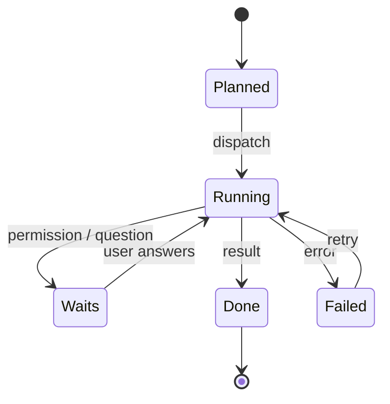
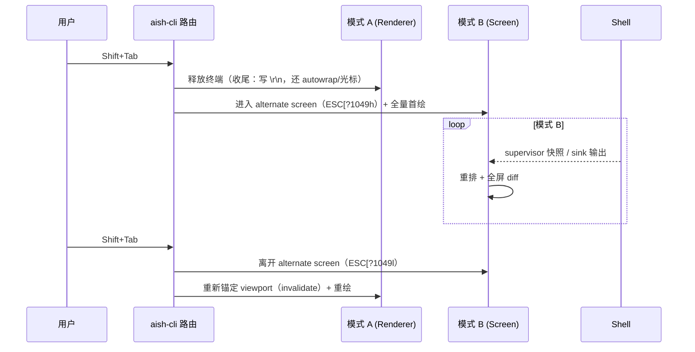

# 全屏 TUI 模式设计方案

状态：**部分实现**。已完成 P0（解绑 Shift+Tab + 模式切换请求）与 P1 布局内核（`screen.rs` 单元格网格与 diff、`workspace.rs` 四页布局、`workspace-demo` 原型）。参考实现：`/home/xzx/nfs/xzx/github/aish/troupe`（TypeScript，tmux 面板）。

## 1. 目标

把 aish 的交互界面从「行内双通道 REPL」升级为「单进程内可切换的双模式」：

| 模式 | 名称 | 布局 | 现状 |
|---|---|---|---|
| A | **滚动模式**（PTY scrolling） | 行内流式：历史下推、prompt 贴底 | 已有，即当前 v2 双通道 REPL |
| B | **全屏模式**（fullscreen） | alternate screen、分区、多 pane | 待实现，参考 troupe |

`Shift+Tab` 在 A/B 之间切换。**本次同时解除 `Shift+Tab` 与 plan 模式的绑定**（plan 模式本身保留，仍可用 `/plan`、F2 或工具 `enter_plan_mode` 触达）。

### 与旧方案的关系

旧 v2 方案（`docs/tui-persistent-status.md`）把「双通道渲染 + 持久状态」当作终点；本方案改变定位：

- 双通道渲染（`aish-tui` 的 history/viewport + `Renderer`）**保留**，成为模式 A 的引擎。
- 模式 B 需要新引擎：单元格画布 + 全屏 diff，行内渲染器不足以表达分区布局。
- HUD / Ctrl+S 面板 / 子代理卡片在模式 A 继续生效；模式 B 用 troupe 式 pane 取代它们，但共享同一份 `aish-supervisor` 快照。

## 2. 为什么不能直接复用行内渲染器

`Renderer::draw` 的契约（`crates/aish-tui/src/frame.rs`）是行内流式的：

1. viewport 贴着 history **向下流式书写**，靠终端自身滚动把旧行推进 scrollback（`place_viewport`，`renderer.rs:395`）。
2. viewport 高于屏幕时**保留尾部**（因为 prompt 在底部）。
3. 从不删除顶部行（终端会把消失的顶行归档进 scrollback）。

全屏模式的假设正相反：**绝对坐标、整屏属于我、任意重绘任意格**。二者不能共用一个 `draw`。

可复用的部分：`render.rs`（ANSI 状态机、CJK 宽度、TAB 展开、`prepare_line`）、`input.rs`（CSI/SS3/UTF-8/粘贴重组）、`caps.rs`、`component.rs`（引用等值 memo）、`output.rs`（sink）。

## 3. 架构

```
                    ┌──────────────────────────────┐
                    │ aish-cli (模式路由 + 状态机)   │
                    └───────────┬──────────────────┘
              Shift+Tab 切换     │
        ┌───────────────────────┴───────────────────────┐
        │                                               │
┌───────▼────────┐                            ┌─────────▼──────────┐
│ 模式 A 引擎     │                            │ 模式 B 引擎         │
│ Renderer       │                            │ Screen + Canvas    │
│ (history/      │                            │ (绝对坐标, 全屏 diff)│
│  viewport)     │                            │                    │
└───────┬────────┘                            └─────────┬──────────┘
        │                                               │
        └───────────────┬───────────────────────────────┘
                        │
            ┌───────────▼────────────┐
            │ aish-supervisor 快照    │  ← 唯一数据源，两模式共享
            │ (agents/tasks/sessions) │
            └───────────┬────────────┘
                        │
            ┌───────────▼────────────┐
            │ aish-core output sink  │  ← 产品输出唯一出口
            └────────────────────────┘
```

关键决策：**模式切换不重建 shell 状态**。两者都是同一进程里对同一 `Shell` 的两个前端，切换只是换渲染器与输入循环。

## 4. 模式 B 的屏幕布局

纵向骨架（照抄 troupe 的 chrome/body/footer 三段）：

```
row 0            标题栏（1 行）：aish · <目标> · <状态> · <clock> · <语言>
row 1            标签栏（1 行）：1 MISSION  2 AGENTS  3 TASKS  4 LOG  5 DIFF
row 2            目标行（1 行，右对齐）
row 3            满宽分隔线 ─
row 4..h-3       主体（吃满剩余高度）
h-2              输入行  ❯ <editor>          （仅 MISSION 页）
h-1              键提示栏（1 行）
```

可用门槛：`width >= 40 && height >= 10`，否则整屏一行提示并只接受 `q`/`Shift+Tab`。

### 主体分栏

MISSION 页是唯一双栏页，左栏固定 **27 列**，`col 27` 画 `│`，右栏从 col 29 起：

```
row4 ─ ROLES ──────────── │ ─ FLOW ─────────────────────────────────
     build                │   ┌─────────────────────┐
       ✓ lock   ⬢  —      │   │ ● main              │
     ▸ └ ○ build ⬢  —     │   └─┬───────────────────┘
     ─ STAGES ─────────── │     └─▶ │ ○ build planned │
       ✓ Plan             │         └─────────────────┘
       ● Build      0/3   │   ─ ○ build · planned ─────────────────
     ─ ACTIVITY ───────── │    goal     Rotate the token on refresh
       12:07 dispatched   │    agent    ⬢ codex gpt-6.1-sol
```

左栏三块：`ROLES`（角色树）、`STAGES`（阶段进度）、`ACTIVITY`（事件流）。
右栏两块：`FLOW`（依赖画布，选中节点双线框）、`detail`（选中角色字段 + 活窗口快照）。

其余四页满宽，左右各留 1 列。

### 配色（沿用 troupe 语义，映射到终端 256/truecolor）

| 语义 | troupe 值 | 用途 |
|---|---|---|
| `bright` | `#e8eaf0` | 正文 |
| `accent` | `#6fa8ff` | 选中、链接 |
| `accentBright` | `#9ac2ff` | 选中高亮 |
| `chrome` | `#4e6991` | 边框、分隔线、脚注 |
| `warn` | `#f4be5c` | 等待你处理、门禁 |
| `ok` | `#98c379` | 完成 |
| `error` | `#e06c75` | 失败 |
| `dim` | `#9aa3ad` | 次级信息 |
| `coral` | `#f08a7e` | Claude 徽标 |
| `cyan` | `#65cbd4` | Codex 徽标 |
| `violet` | `#b994f0` | 编排者 |
| `pink` | `#e58fc0` | 强调 |

字符集全部是 BMP 制表符（`─│┌┐└┘├┤┬┴┼`）、盲文（`⣾⣽⡿`）、几何符号（`●○✓✓▸▍◼◻`），**无 Nerd Font 依赖**——与现有 `HudState` spinner 一致。

## 5. 状态模型



角色行状态优先级（照 troupe `state.ts`）：`planned → closed → result → gone → idle/working`。状态驱动图标与色调：

| 状态 | 图标 | 色调 |
|---|---|---|
| planned | `○` | dim |
| running | `●` | accent |
| waits | `◆` | warn |
| done | `✓` | ok |
| failed | `✗` | error |
| gone | `—` | chrome |

数据来源：现有 `aish-supervisor::SupervisorSnapshot`（`AgentRun`/`TaskRow`/`SessionRow`），**不新增数据源**。

## 6. 输入与焦点

| 键 | 动作 |
|---|---|
| `Shift+Tab` / `F2` | 切换模式 A ↔ B |
| `↑`/`↓`、`j`/`k` | 选择角色 / 行 |
| `Enter` | 打开 detail |
| `1`–`5` | 切标签页 |
| `o` | 打开该 agent 的 PTY 窗口（模式 A 里 attach） |
| `s` | 向该 agent 发消息 |
| `d` | 看 diff |
| `r` | 停止 / 重试任务 |
| `?` | 帮助浮层 |
| `q` | 关闭面板（回到模式 A） |
| `Ctrl+C` | 中止当前回合 |

焦点区域的视觉标识：选中行前缀 `▸`，选中卡片用双线框 `╔═╗`，`detail` 头部 `─ ○ build · planned ───`。

## 7. 渲染策略

| 项 | 决策 | 理由 |
|---|---|---|
| 屏幕缓冲 | `Vec<Cell>` 宽×高，`Cell { ch, fg: Option<Rgb>, bg: Option<Rgb>, bold }` | 绝对坐标，diff 简单 |
| 首绘 | 全量写（`ESC[H` + 逐行） | 进入模式 B 或 resize 后 |
| 增量 | 只写变化格，连续变化的格子合并成一段（gap ≤ 4） | troupe `screen.ts:diff` |
| 原子性 | 整帧包在 `ESC[?2026h..l` 同步块内；光标隐藏 | 与现有 `Renderer::paint_begin` 同策略 |
| resize | 全量重绘 + 布局重算 | |
| 长列表 | 内容驱动滚动，底栏永不压缩 | troupe 规则 |
| 帧率 | 40ms（25fps），**仅在「有东西在动」时启停** | 空闲不耗 CPU |

动画：spinner 盲文帧、shimmer（渐变扫过选中行）、呼吸（等待中的角色行）、sparkline（tokens/s）、依赖边数据包流动。全部是「在已绘制的 `Cell` 网格上按时间重着色」，不重跑布局。

## 8. 模式切换的实现路径



要点：

- `ESC[?1049h` 保存光标与屏幕，`ESC[?1049l` 原样恢复——模式 A 的历史不会被模式 B 弄脏。
- 模式 A 的 `Renderer` 在切换时 `invalidate()`，回来时全量重画一次（现有 API 已具备）。
- 模式 B 里提交的命令仍然走 `Shell::process_line`，输出进同一个 `OutputSink`；在模式 B 下 sink 把行喂给「LOG 页 + 当前 pane」，而不是 history 通道。

## 9. 分阶段落地

| 阶段 | 内容 | 状态 | 可验证结果 |
|---|---|---|---|
| **P0** | 解绑 `Shift+Tab`（保留 F2 与 `/plan`）；`Repl::take_mode_switch()` 上报切换请求 | **已完成** | Shift+Tab 不再触发 plan 模式；REPL 不把该键写进 buffer，且不会在切换后重开补全菜单 |
| **P1** | `crates/aish-tui/src/screen.rs`（Cell 网格 + 逐格 diff）+ `workspace.rs`（四页布局）+ `workspace-demo` 原型 | **已完成** | 静态四页在真实终端正确渲染，列对齐、空白保留、CJK 不撕裂，tab 可切换 |
| **P2** | 接 `SupervisorSnapshot`：ROLES/STAGES/ACTIVITY 真实数据 | 待做 | 跑真实任务时面板实时更新 |
| **P3** | 输入路由：动作（open/send/stop/diff）+ 40ms 动画层 | 待做 | 键位全通，空闲不耗 CPU |
| **P4** | 把 mode B 接进 `aish-cli`（进入/离开 alternate screen 与 REPL 互切） | 待做 | Shift+Tab 在真实 shell 里来回切换 |
| **P5** | HUD / Ctrl+S 面板功能迁到模式 B；模式 A 可选择性移除 HUD | 待做 | 两模式功能对等 |

每阶段可独立回退。

## 10. 风险与取舍

| 风险 | 影响 | 缓解 |
|---|---|---|
| 全屏引擎是第二套渲染器，长期维护成本翻倍 | 高 | 只共享 ANSI 状态机/CJK 宽度/输入解析，不强行统一 draw 契约 |
| 模式切换时终端残留脏状态 | 中 | 切换必须走 `TerminalGuard` 的释放/重建路径；加 PTY 测试断言切换前后 scrollback 不变 |
| alternate screen 在 tmux/SSH 下行为差异 | 中 | 已测 tmux；SSH 需实测；不可用时降级为「清屏 + 绝对定位」 |
| troupe 是 tmux 内嵌 pane，aish 是单进程 | 中 | FLOW 画布/活窗口快照需要自绘；不能直接 tmux 分屏 |
| supervisor 数据当前是拉取式 | 低 | 模式 B 用 2s 轮询对齐 troupe；后续可改事件推送 |

## 11. 与已实现部分的衔接

| 已存在 | 在新方案中的角色 |
|---|---|
| `aish-tui::{Renderer, Frame, HistoryBatch}` | 模式 A 引擎，不变 |
| `aish-tui::repl::Repl` | 模式 A 主循环，增加「切换模式」出口 |
| `aish-tui::{HudState, SupervisorPanel}` | 模式 A 的状态栏/面板；模式 B 的数据来源之一 |
| `aish-supervisor::SupervisorSnapshot` | **两模式共享的唯一状态源** |
| `aish-tui::{render, input, caps, output}` | 两模式共享的基础层 |
| `todo` 工具 + checklist 渲染 | 模式 A 行内卡片；模式 B 变成 STAGES 页的一部分 |
| plan 模式（`PlanPhase`、`enter_plan_mode`） | **保留**，只是不再占用 `Shift+Tab`；可作为模式 B 的「门禁框」数据源 |

## 12. 已落地代码

| 文件 | 内容 |
|---|---|
| `crates/aish-tui/src/screen.rs` | `Cell` / `Screen` / `CellStyle` / `Diff`。`Screen::put` 处理 TAB 展开、CJK 双宽、控制字节剥离；`diff()` 只寻址变化格并把间隙 ≤ 4 的合并成一段；`render_full()` 首绘。**空白格必须写出空格**，双宽字形的右半格用独立 `continuation` 标志标记（用「`ch` 为空」兼作标记会吞掉所有空格，把 `state waits` 变成 `statewaits`）。 |
| `crates/aish-tui/src/workspace.rs` | `Workspace` / `draw()` / `Palette` / `Tab` / `AgentState`。四页布局（MISSION 双栏 27 列、AGENTS、TASKS、LOG）；标题栏为右侧分段预留空间，tab 标签间 4 列，detail 字段值与标签分列。 |
| `crates/aish-tui/src/bin/workspace-demo.rs` | 原型：alternate screen + raw mode + 逐字节按键解析（`1`-`4`、`Tab`/`Shift+Tab`、`j`/`k`、`q`）。 |
| `crates/aish-tui/src/repl.rs` | `Repl::take_mode_switch()`：Shift+Tab 被 REPL 吞下并上报，不进入 buffer，不重开菜单。 |
| `crates/aish-shell/src/readline.rs` | `BackTab` 绑定删除；F2 是唯一的 plan 模式开关。 |

### 验证状态

- `cargo test -p aish-tui --lib`：189 passed（新增 33）。
- 真实终端（tmux 100×30）：四页正确渲染；`1`-`4` 与 `Shift+Tab` 切换；`j` 移动选中并同步右侧 detail；`q` 退出并还原主屏。
- 已修复的原型期缺陷：空白列被吞（`statewaits`）、状态列溢出（`plannereview`）、`put_right` 差一列、标题与右侧分段粘连、无 raw mode 导致按键不达。

## 13. 剩余待办

1. **P4**：`aish-cli` 里加 `UiMode` 状态机，Shift+Tab 真正在 REPL 与全屏之间切换（进入 `ESC[?1049h`、离开 `ESC[?1049l`，并保证 REPL 的 `Renderer::invalidate()` 在返回时触发）。
2. **P2**：`workspace.rs` 的 `Workspace` 由 `aish-supervisor::SupervisorSnapshot` 转换而来，替换 `workspace-demo` 的静态样例。
3. **P3**：动作路由（open/send/stop/diff）与 40ms 动画层。
4. vt 屏 residter 断言：切换前后 `capture-pane` 的 scrollback 一致。
