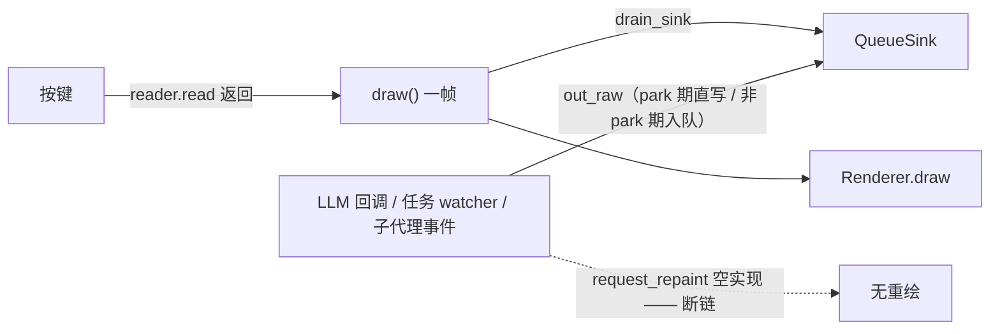

# TUI 常驻状态显示（对齐 oh-my-pi）

> 状态：**部分实现**。HUD / 监督面板 / Supervisors 快照 / todo 状态机已落地并接入默认前端；
> **空闲期自动重绘（阶段 0）仍未实现**，因此任务/子代理完成后 HUD 不会自行消失，
> 要等到下一次按键。剩余差距与实现路径见 §5。
>
> 基线：`feat/bg-task` @ `0d12225` 之后的未提交改动（`cargo test --workspace --lib` 全绿：20 crate / ~2700 测试）。
> 文中 `文件:行` 均指当前工作树。

---

## 0. 需求

**原始需求**（用户提出）：

> 按目前最新代码，分析 oh-my-pi 一致的 task jobs、TODO、Subagents 以及任务状态的 TUI 常驻显示方式，目前 aish 能否支持。

拆成可验收条目：

| # | 需求 | 判定标准 | 现状 |
|---|---|---|---|
| R1 | **task jobs 常驻**：后台任务运行数、状态、完成事件持续可见 | 任务结束时 HUD 自行更新；完成行进入 transcript | ⚠️ 显示已就绪，**自动更新未就绪**（需按键） |
| R2 | **TODO 常驻**：当前 phase/任务清单作为粘性块常驻 | 任意时刻可见 `[phase] done/total` 与 in-progress 项 | ⚠️ 工具卡片内渲染正确；未做粘性块 |
| R3 | **Subagents 常驻**：每个活着的子代理一行（类型/状态/工具数/耗时） | 启动即出现，结束即退休 | ✅ HUD 摘要 + Ctrl+S 面板 Pinned 语义（面板内），**已修退休** |
| R4 | **任务状态常驻**：模型、ctx、spinner、中断状态实时 | 流式期间与结束后同一行反映真实状态 | ✅ HUD 行（`⣾ ██████░░░░ 63%`） |
| R5 | **一致性**：语义与 oh-my-pi 对齐（字段、状态机、折叠阈值、隐藏策略） | 见 §2 对照表 | ⚠️ 见 §3 逐项 |

非目标：复刻 omp 的 Agent Hub 全部交互（revive/park/IRC 未读计数）——aish 尚无后台化与停放生命周期。

---

## 1. 结论

**已落地四块零件并接入默认前端**，缺的是把它们**自行驱动**起来的那一环。

| 零件 | 实现 | 文件 |
|---|---|---|
| 双通道渲染内核 | history（只增 + ack）+ viewport（帧 diff）+ 原子绘制 | `crates/aish-tui/src/renderer.rs` |
| HUD 状态行 | `HudState`：左段 + supervisor 摘要 + spinner + 10 格 ctx 条；三级让位（gap→summary→left） | `crates/aish-tui/src/hud.rs` |
| 全屏监督面板 | `SupervisorPanel`：Agents/Tasks/Sessions 三 tab、选择标记、右键详情、自动滚动、动作产出 | `crates/aish-tui/src/panel.rs` |
| 快照聚合 | `Supervisor`：agents（事件增量）+ tasks（注册表）+ sessions（PTY 发现） | `crates/aish-supervisor/src/` |
| todo 状态机 | 7 ops、逐字内容标识、auto-promote、4 态 | `crates/aish-tools/src/todo/` |
| 输出路由 | `OutputSink`（core）+ `QueueSink`（tui）+ PTY 尊重 `owns_screen()` | `aish-core/src/output.rs`、`aish-pty/src/persistent.rs` |

**仍缺的那一环**（§5 阶段 0）：`OutputSink::request_repaint()` 是空实现
（`aish-tui/src/output.rs:135`），`Repl::run` 在 `reader.read` 上阻塞
（`aish-tui/src/repl.rs:352`），唯一的非按键绘制路径是 50 ms 的 Esc 超时轮询。

---

## 2. oh-my-pi 的机制（对照基线）

omp 的常驻显示是**三层**，而不是"几个组件"：

| 层 | 机制 | 关键事实 |
|---|---|---|
| 帧层 | `TerminalFramePlan { history?, viewport }`，product 每帧重新提交完整 viewport | 每帧重算 chrome；history 只在 product 判定 final 时追加，append-only + 单调 id + ack |
| 组合层 | chrome 先占位（editor、status、HUD、overlay），剩下的行才给 transcript | 常驻块是 **chrome**，永不被 transcript 挤掉 |
| 状态层 | 每帧从 live 状态读；状态变更 → 请求重绘 | 渲染是纯函数，状态源是唯一真相 |

四个常驻面：

| 面 | omp | aish 对应 |
|---|---|---|
| 状态行 | 底部 chrome：model、cost（峰谷箭头）、ctx 百分比、vim 模式 | `HudState`（左段 + ctx 条 + spinner），缺 cost/vim |
| TODO HUD | 粘性块，`/todo expand\|collapse`；折叠上限 8；全清后 `todoClearDelay`（默认 60s）隐藏 | todo 状态机已有；**无粘性块、无延迟隐藏** |
| Subagents | editor 上方 pinned 块；`display.pinnedAgents: collapsed\|full\|off` | Ctrl+S 面板内的 Agents tab；**无 pinned 块** |
| Agent Hub | `Alt+A` / `Ctrl+S` 全屏 roster + inspector | `SupervisorPanel`（三 tab，无 inspector） |

状态机对照：omp `running/idle/parked/aborted` + `agentIdleTtlMs`（420s 停放）；
aish `AgentState{Running,Completed,Failed,Cancelled}` + `prune_finished(3s)` 保留窗口 + `finish_stale(idle_ms)` 兜底 API（未接线）。

---

## 3. aish 现状逐项

### 3.1 已实现并验证

| 面 | 实现细节 | 文件:行 |
|---|---|---|
| 状态行 | `render(width)` 单行；fit 顺序 gap → summary → left；`visible_width <= width` 有 fuzz 测试 | `hud.rs` |
| 面板 | 三 tab + 计数 `Agents(2) Tasks(1) Sessions(3)`；`▸` 选择；detail 右对齐；tone 着色；`take_action()` 产出 `StopTask/CancelAgent/AttachSession` | `panel.rs` |
| 快照 | agents 由 `LlmEvent` 增量；tasks 用 `list_tasks()`（**绝不 drain**，有测试锁定）；sessions 用 `discover_sessions()` | `snapshot.rs` |
| 子代理终态 | `spawn()` 在 `tokio::select!` 后 emit 一个 `OpEnd`（`source=sub_agent`、`reason` 按 outcome）；`AgentTracker` 接受带 `spawn_id` 无 `source` 的终态；负向对照：stub 掉 emit 后 4 个测试全失败 | `spawn.rs`、`agents.rs` |
| PTY 输出 | `write_stdout_all` 先 `normalize_crlf`，`owns_screen()` 为真则走 sink | `persistent.rs:68` |
| 回合期输出 | `Repl::park()`：清 live band → 装 `StdoutSink` → 恢复 OPOST\|ONLCR；`ParkGuard` 保证 panic 也 unpark | `repl.rs` |
| slash 补全 | `SlashCommandSource`（28 命令）+ `path_words()`；输入 `/` 即弹菜单（与 legacy 一致），Up/Down 选中（`CURSOR_ON` 反显）、窗口随选中滚动、Enter 接受并提交、Esc 关闭；菜单 10 行 + `… 18` | `completion.rs`、`repl.rs` |
| 光标宽度 | prompt 用 `visible_width`（ANSI 不计宽）；`wrap_logical` 仅宽字符换行；`render_with_cursor(width)` 不超宽 | `editor.rs`、`highlight.rs` |

### 3.2 未实现 / 差距

| 面 | 差距 | 影响 |
|---|---|---|
| **自动重绘** | `request_repaint()` 空实现；`Repl::run` 阻塞读 | 任务/子代理完成后 HUD 残留到下一次按键 |
| TODO 粘性块 | 无 `TodoView`、无版本号订阅、无 `/todo expand\|collapse` | 清单只在 todo 工具卡片那一瞬 |
| Subagents pinned 块 | 无 editor 上方常驻行 | 需 Ctrl+S 才能看到 |
| 完成行 | `drain_background_task_notices` 只在 `AishShell::run`（legacy 路径） | v2 下后台任务完成行不出现 |
| 面板动作 | `CancelAgent` / `AttachSession` 是 `eprintln!` 占位 | 只能停止任务 |
| HUD 数据 | `set_left` / `set_ctx_percent` 仅测试调用 | 左段（model/cwd）与 ctx 条实际为空 |
| spinner 单写者 | `SharedAnimation` 仍直接 `print!` fd 1（`sink_is_stdout()` 只门控了 reasoning overlay） | v2 回合期两条 spinner 可能抢屏 |

---

## 4. 根因

1. `Repl::run` 只在两个时刻绘制：进入循环、处理完一次读（`repl.rs:352`）。无第三个触发点。
2. `OutputSink::request_repaint()`（`aish-core/src/output.rs:77`）是所有生产者都能到达的进程级钩子，
   但 `QueueSink` 实现为空（`aish-tui/src/output.rs:135`）。**管道已铺好，只差一个置位。**
3. todo 状态（`todo/mod.rs` 的 `LazyLock<Mutex<State>>`）无版本号/无订阅，不属于 TUI 数据模型。

---

## 5. 剩余实现路径

顺序即依赖顺序。**阶段 0 是其余全部的先决条件。**

### 阶段 0：重绘驱动（约 60 行，集中在 `aish-tui`）

1. `QueueSink` 加 `Arc<AtomicBool>` 唤醒位，`request_repaint()` 置位；`ReplConfig::wake` 让 REPL 读到同一位。
2. `Repl::run` 的阻塞读改为 `poll(fd, TICK=100ms)`（复用已有的 `reader_ready()` 实现）：
   可读 → 原路径；超时且唤醒位置位 → `swap(false)` 后 `draw()`。
3. 生产者置位点：
   - `Supervisor::observe` 返回 `Some(ChangeKind)` 时（`snapshot.rs`；`cli/main.rs` 目前丢弃返回值）
   - 任务 watcher 写 `pending_finished` 之后（`task/mod.rs`）
   - `todo_op` 成功之后（阶段 2）
4. 测试 `Cursor` 恒 ready，保持现有 REPL 单测字节不变（`no_hud_config_preserves_bytes` 语义不变）。

**验收**：后台任务 6s 结束 → 3s 内 HUD 变空且完成行入 transcript，零按键；
`cargo test -p aish-tui -p aish-supervisor` 全绿。

### 阶段 1：spinner 单一写者

1. `screen_owned()` 为真时不启动 `SharedAnimation`（`animation.rs:83,184`）。
2. 忙碌状态进 `HudState.left`，`HudState::tick` 推进 spinner。
3. 接上 `set_left`（model + 耗时）与 `set_ctx_percent`（`response_footer` 同源字段）。

**验收**：同一时刻屏幕上只有一个"思考中"；`tests/tui/test_animation.py` legacy 语义不变。

### 阶段 2：TODO 粘性块

1. `aish-tools/src/todo` 加 `version: AtomicU64` + `pub fn snapshot() -> (u64, Vec<TodoPhase>)`。
2. `aish-tui` 新增 `TodoView`（纯数据）+ 渲染：`[phase] d/t` 头 + `☐ ◐ ☑ ✗`，折叠上限 8（对齐 omp `COLLAPSED_ITEMS`）。
3. `ReplConfig::todo: Arc<dyn Fn() -> Option<TodoView>>`，与 `hud` 同帧读取。
4. 隐藏策略 `tui.todo_clear_delay_secs`（默认 60，0 立即，<0 关闭）。
5. `/todo expand|collapse`（新增 slash 命令）。

**验收**：`todo init` 后无需按键即可见；全清后按时隐藏；resize 重排不溢出。

### 阶段 3：Subagents pinned 块

1. 复用 `SupervisorPanel` 的行渲染，在 editor 上方输出 pinned 块：`collapsed`（3 行 + 展开提示）/`full`/`off`，配置 `tui.pinned_agents`。
2. 退休已实现（`prune_finished(3s)`），pinned 块直接消费同一快照。

**验收**：子代理启动即出现、结束即消失。

### 阶段 4：任务动作与完成行

1. `drain_background_task_notices` 从 `AishShell::run` 提到 `process_line`；`println!` 改 `out_line!`。
2. `CancelAgent` 需要 per-spawn 子 token（方案 A，小）；Agent 后台化（方案 B，大）单独立项。
3. `AttachSession` 接 `aish-pty` attach 路径。

---

## 6. 门禁

| 断言 | 位置 | 注意 |
|---|---|---|
| `SLASH_COMMANDS.len() == 28` | `aish-shell/src/readline.rs`、`tests/slash_popup_commands.rs` | 加 `/todo` 后改 29 |
| `MENU_ROWS = 10` | `aish-tui/src/repl.rs` | 菜单行数变更需同步测试 |
| i18n 覆盖率 | `aish-i18n/src/manager.rs` | 新 key 必须 en-US + zh-CN 都写 |
| REPL 字节契约 | `aish-tui/tests/renderer_contract.rs`、`repl.rs` 单测 | 阶段 0 的 tick 不得改变 idle 字节 |
| `no_hud_config_preserves_bytes` | `aish-tui/src/repl.rs` | tick 引入后仍需逐字节相同 |

## 7. 风险

| # | 风险 | 缓解 |
|---|---|---|
| R1 | 每帧 `Supervisor::snapshot()` 调 `discover_sessions()`（read_dir + json + `is_pid_alive`），10Hz 放大 | tasks/sessions 按 `ChangeKind` 失效 + 最小刷新间隔（500ms） |
| R2 | spinner 线程与 renderer 抢屏 | 阶段 1 一刀切掉 v2 的线程 |
| R3 | tick 与按键唤醒竞争导致重复 draw | draw 幂等（renderer memo 差分）+ `swap(false)` 单次消费 |
| R4 | 面板打开期间整屏重绘成本 | 仅在 `ChangeKind` 或唤醒位置位时重绘 |
| R5 | 新增 slash 命令导致数量断言失败 | 同步改断言 + CHANGELOG |

## 8. 验证状态

| 项 | 结果 |
|---|---|
| `cargo test --workspace --lib` | 20 crate / ~2700 测试全绿 |
| `cargo clippy --workspace --all-targets` | 0 警告 |
| `cargo fmt --all --check` | 干净 |
| PTY 端到端（tmux，100×30） | 命令输出独立成行；AI 工具卡片即时出现；Ctrl+S 面板开合正常；Esc 不吞字符；HUD 显示 `1 task · 1 session⣯` |
| `tests/tui`（tui-test 0.1.1，双二进制对比） | 新前端 19 passed / 9 skipped；slash 补全已修 |
