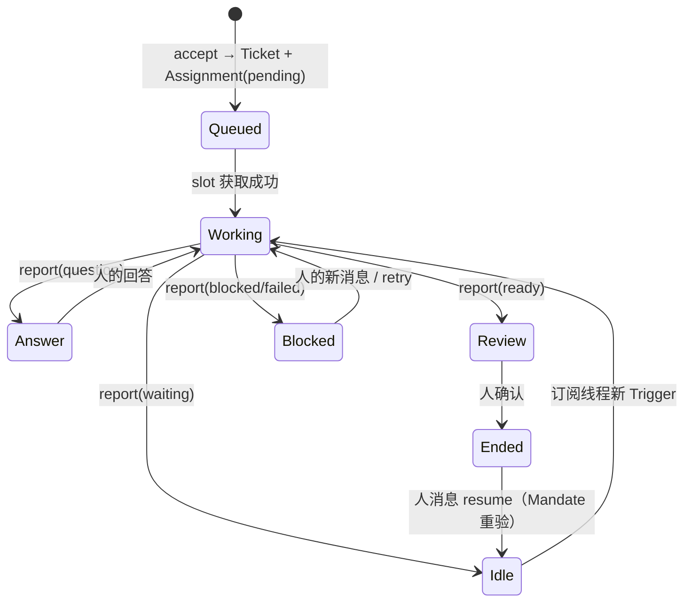
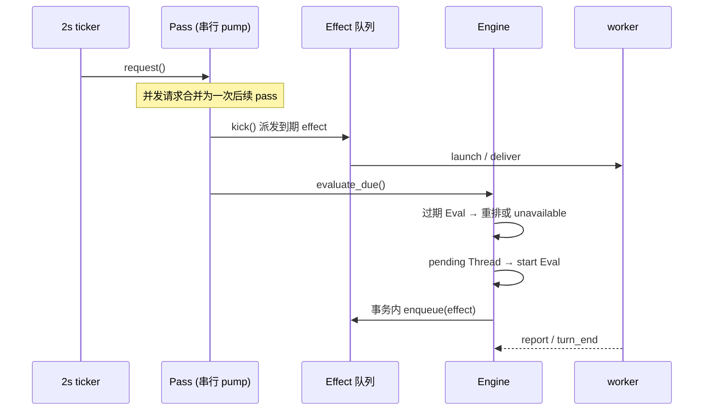

# TUI Superagent / Supervisor 设计

状态：**设计**（未实现）。取代 `docs/tui-fullscreen.md` 中「FLOW 画布 + 静态四页」的临时方案。
参考实现：
- `/home/xzx/nfs/xzx/github/aish/dsh-superagent-prototype`（架构与状态机，TypeScript）
- `/home/xzx/nfs/xzx/github/aish/troupe`（面板布局与视觉语言，TypeScript）

## 0. 为什么需要重做

前一版全屏方案只回答了「怎么画」：四个 tab、一份 `SupervisorSnapshot`、`AgentLine` 六个字段。它没有回答「supervisor 如何组织工作」，于是画出来的东西没有可操作性——agent 列表是只读的，没有授权、没有派工、没有等待人的语义、没有失败恢复。

dsh-superagent 给出的是**另一层东西**：一套把「一段授权工作」从受理推进到结束的状态机，以及保证它崩溃后可恢复的持久化边界。TUI 只是这套状态机的视图与操作面。

因此本文档的重心是**状态机**，UI 是它的投影。

## 1. 三层结构

```
┌────────────────────────────────────────────────────────────┐
│  视图层  aish-tui                                          │
│  四页投影 + 键盘操作 + 40ms 动画                            │
│  只读 ViewModel，只发 Command                               │
└────────────────────────┬───────────────────────────────────┘
                         │ Command（不可变意图）
                         │ ViewModel（不可变快照）
┌────────────────────────▼───────────────────────────────────┐
│  领域层  aish-supervisor                                    │
│  Engine：唯一写入者，同步事务                                │
│  Trigger → Eval → Mandate → Ticket → Assignment            │
│  纯函数：stage / gate / canRetry / waitsForPerson            │
└────────────────────────┬───────────────────────────────────┘
                         │ Effect（持久化队列）
┌────────────────────────▼───────────────────────────────────┐
│  执行层  aish-llm / aish-pty                                │
│  每个 Ticket 一个 worker 会话（create_subsession）           │
│  后台任务、PTY 进程                                         │
└────────────────────────────────────────────────────────────┘
```

**单向数据流**：Command 进、Effect 出、ViewModel 上浮。视图层永不直接改状态，领域层永不直接画屏。

## 2. 领域模型（照搬 dsh，按 aish 裁剪）

### 2.1 实体

| 实体 | 关键字段 | 状态 | 在 aish 的角色 |
|---|---|---|---|
| **Trigger** | `id`（内容寻址）、`kind`、`actor`、`human`、`text`、`at`、`thread` | 无状态，`disposition` 记录去向 | 一次输入事件：用户提问、后台任务完成、子代理回报、定时检查 |
| **Thread** | `key`、`pending[]`、`evaluating?`、`subscriptions[]` | 派生：`evaluating / queued / subscribed / dormant` | 一串相关 Trigger 的一致性边界；**同一时刻最多一个 Eval** |
| **Eval** | `id`、`triggerIds[]`、`strength`、`deadline`、`pausedAt?` | 进行中 → Decision；超时重排 ≤2 次后 `unavailable` | 判断「这批 Trigger 是否该起活」 |
| **Decision** | `kind`、`reason[]`、`strength`、`ticketId?` | `accept / ignore / stop / unavailable` | 判定结果与审计 |
| **Mandate** | `strength`、`policyVersion`、`basis`、`scope` | 不可变；仅人 stop 或 policy 失效可撤 | **为什么这段活可以做、能做多远** |
| **Ticket** | `id`、`title`、`mandate`、`stage`、`inputs[]`、`assignments[]` | 见 §2.2 | 一个授权工作单元 |
| **Assignment** | `id`、`state`、`report?` | `pending / running / ended` | Ticket ↔ worker 会话的绑定 |
| **Report** | `state`、`summary`、`question?` | `progress / waiting / ready / blocked / failed / dropped` | worker 回传的结构化事实 |

### 2.2 Ticket stage（纯函数，首中即止）

照搬 `dsh/stage.ts` 的判定顺序：

| 顺序 | Stage | 条件 | 面板标签 | 谁能推进 |
|---|---|---|---|---|
| 1 | `ended` | `ended == true` | — | — |
| 2 | `person/delivery` | 输入投递失败，重试中 | 输入未送达 | 自动重试 |
| 3 | `person/answer` | 有开放 `attention` | **等你回答** | 人 |
| 4 | `person/review` | 最新 Report 是 `ready` | **等你审阅** | 人 |
| 5 | `person/blocked` | Report `blocked`/`failed` 且此后无人发言 | **卡住 / 失败** | 人 |
| 6 | `working/queued` | 无 Assignment 或 pending | 排队中 | slot 释放 |
| 7 | `idle` | Report `waiting` 或 Assignment 已结束 | 等 Trigger | Trigger |
| 8 | `working` | 其余 | 工作中 | worker |

**关键不变量**：只有结构化 `attention` 才能进入 `person/answer`。禁止从自由文本推断「在等人」——这是 dsh 明确拒绝的概念，也是面板安静的前提。



### 2.3 与 aish 现有能力的映射

| dsh 概念 | aish 现成对应 | 差距 |
|---|---|---|
| Main Session（orchestrator） | 主 `LlmSession` | 已有 |
| Executor Session（worker） | `LlmSession::create_subsession()` | **能并发**，但 `AgentTool` 目前串行等待 |
| worker 目录隔离 | 无 | 需加：每 Ticket 一个 cwd（可选 `git worktree`） |
| worker slot | 无（串行） | 需加：并发闸门 |
| Report | `SpawnResult` | 需加结构化 `question` 字段 |
| Channel 回写 | 终端输出 | 改为写入 Ticket 的显示区 |
| Policy / Gate | 无 | 需加：最小版（谁可以起活） |
| SQLite store | 无（只有会话记录） | 需加：Ticket/Effect 表 |

## 3. 控制循环

照搬 dsh 的 **pass 心跳 + 串行 pump**：



**pass 不是工作单元**，是调度心跳。它只做三件事：
1. 派发到期 effect；
2. 让过期 Eval 重排或判 `unavailable`；
3. 为有 pending Trigger 的 Thread 启动 Eval。

**在新 TUI 里**，pass 由两处驱动：2s 定时器，以及每次用户按键后的 `request()`（保证操作立刻反映）。

## 4. 授权模型（最小可用版）

dsh 的 gate 有 4 种途径（addressed / admission / followup / bot）。aish 是单人本地 shell，不是多人 IM，**只保留两条**：

```
gate(trigger):
  # 用户直接输入的问题 → 显式授权
  if trigger.human and trigger.kind == UserAsk:
      return ADMITTED(explicit, via=direct)

  # 系统事件（后台任务完成、子代理回报）→ 仅在已有 Ticket 时视为 followup
  if trigger.kind in {TaskDone, AgentReport}:
      if thread.has_open_ticket:
          return ADMITTED(inferred, via=followup)
      return NOT_ADMITTED(no_ticket)

  # 其余一律不自动起活
  return NOT_ADMITTED(not_a_request)
```

**强度语义**（照搬）：
- `explicit`：用户明确要求 → 可做大改动、可越界。
- `inferred`：系统推断（续做已有工单）→ 只做小改动，超范围必须 `report dropped` 交回人。

**恢复时重验**：`ended` 的 Ticket 收到新消息要 resume，必须重新 `revalidate(mandate)`——policy 版本变了就不能凭旧授权复活。

## 5. 并发与隔离

### 5.1 worker slot

```rust
// 照搬 dsh 的 dsh.ts:WorkerSlots：人消息可用额外 1 个 slot
fn can_start(&self, by: WakeSource) -> bool {
    let limit = self.max_workers + if by == WakeSource::Person { 1 } else { 0 };
    self.used() < limit
}
```

不变量：**新工作永远不能挡住人继续已有工单**。

### 5.2 每 Ticket 一个会话 + 一个目录

```rust
struct TicketExecution {
    session: LlmSession,   // create_subsession()，独立上下文与取消令牌
    dir: PathBuf,          // <work_root>/<ticket_short_id>
    jobs: Vec<JobHandle>,  // 后台任务
}
```

`aish-llm::spawn` 已是 `async` 且每次 `create_subsession()`，天然支持并发——这是整件事可行的前提。当前 `AgentTool` 串行只是工具层的等待策略，`Ticket` 层可以直接并发跑多个。

### 5.3 后台任务

照搬「turn 结束但仍有后台任务时保持 worker slot、不报 waiting」：

- turn 结束且 `jobs` 非空 → 仍占 slot，stage 保持 `working`；
- 后台任务完成 → 唤醒同一 slot 继续；
- 30 分钟上限：杀 shell job、报 `waiting`。

## 6. 失败与重试

| 分类 | 判定 | 处理 |
|---|---|---|
| transient | 网络类（timeout / reset / 5xx） | 指数退避 2s→60s，最多 3 次 |
| Later | 无 slot / 暂停 | 延迟但不计失败次数 |
| permanent | 其余 | 立即 `report failed`，转 `person/failed` |
| Eval 超时 | deadline 到期 | 重排 ≤2 次，之后 `unavailable`（可 dismiss） |

health：每个 effect kind 连续 3 次失败 → 面板报错（照搬 `FAILURES_BEFORE_ERROR`）。

## 7. 持久化

最小集（照搬 dsh 的「先存后做」）：

```sql
ticket(id, title, mandate_json, stage, ended, created_at, updated_at)
assignment(id, ticket_id, state, report_json, started_at, ended_at)
input(ticket_id, seq, kind, payload_json, delivered_at, read_at)
effect(seq, kind, payload_json, attempts, due_at, generation, error)
trigger(id PRIMARY KEY, payload_json, disposition_json)   -- 内容寻址，幂等
receipt(id PRIMARY KEY, state)                            -- outbox 幂等
kv(key PRIMARY KEY, value)
```

**为什么需要 effect 队列**：领域事务里不能做 IO。命令在事务内 `enqueue(effect)`，提交后才执行。崩溃后重启，未完成的 effect 仍在表里，这是「已决定要做的动作绝不丢失」的唯一实现方式。

**为什么需要 receipt**：同一回复/派工永不二次执行。`INSERT OR IGNORE` + 内容寻址 id 即幂等。

## 8. TUI 投影（四页）

数据全部来自 Engine 的只读投影，不 fold 历史。

| 页 | 内容 | 回答的问题 |
|---|---|---|
| **NOW** | 待人工（stage ∈ person/*）+ 系统问题 | 现在需要我吗？ |
| **WORK** | Ticket 列表，按 stage 分组，含 slot 使用率 | 系统在正常干活吗？ |
| **TRACE** | 单个 Ticket 的时间线：Trigger → Eval → Decision → Assignment → Report | 这件事怎么走到这一步的？ |
| **CONFIG** | 并发上限、work root、policy 版本 | 参数对不对？ |

布局沿用 `troupe` 的 chrome/body/footer 三段与 12 色语义调色板（已实现在 `workspace.rs` 的 `Palette`）。

**安静原则**（照搬 dsh §Principles）：健康态不占空间；一个数只有会改变人的行为时才显示；需要人的行直接给出动作键。

键位（相对前一版的关键改动）：

| 键 | 动作 | 页 |
|---|---|---|
| `j/k` `↑↓` | 移动选中 | 全部 |
| `⏎` | 进入 TRACE | NOW/WORK |
| `a` | 回答（打开输入行） | person/answer |
| `v` | 审阅（进入 TRACE + diff） | person/review |
| `r` | retry（仅 `canRetry` 为真） | person/blocked+failed |
| `s` | 停止（撤回 Mandate，需确认） | 全部 |
| `Tab`/`Shift+Tab` | 切页 / 退出全屏 | 全部 |
| `q` | 退出全屏 | 全部 |

## 9. 落地阶段

| 阶段 | 内容 | 验证 |
|---|---|---|
| **S0** | 领域类型 + `ticketStage`/`canRetry` 纯函数（无 IO、无 UI） | 单测覆盖 stage 全部 8 行判定 |
| **S1** | Engine 同步事务 + 内存 store + effect 队列（仍无 IO） | 单测：命令 → effect 入队 → 崩溃重启重放 |
| **S2** | 接 `LlmSession::create_subsession` 真跑 worker；slot 闸门 | 集成：3 个 Ticket 并发，第 4 个排队；人消息插队 |
| **S3** | TUI 投影到已有 `screen`/`workspace`；操作发 Command | tmux：真实 Ticket 走完 Queued→Working→Review→Ended |
| **S4** | 持久化（SQLite）+ 崩溃恢复（`assignmentInterrupted`） | 杀进程重启，Ticket 状态与 effect 队列正确恢复 |

**S0/S1 完全无 IO**，可先落地并把状态机钉死，避免 UI 先行导致的返工。

## 10. 明确不做

| 不做 | 理由 |
|---|---|
| GitHub / Feishu Source | aish 是本地 shell；Trigger 只有用户输入、后台任务、子代理 |
| 多人授权名单、admission 表 | 单人本地环境无此概念 |
| PR 跟随与合并闭环（`follows`） | 无 PR 概念 |
| prompt 版本修订与 `mayRead` | dsh 为解决 harness 模型演进而设，aish 不需 |
| React 面板 / HTTP 路由 | TUI 自绘 |
| dsh 的后台 job kill 机制细节 | aish 有自己的进程模型，只保留「后台任务占 slot、完成唤醒」的概念 |

## 11. 与现有代码的关系

| 现有 | 处置 |
|---|---|
| `crates/aish-tui/src/{render,screen,workspace,app}.rs` | **保留**：渲染内核与布局基元可复用 |
| `workspace.rs` 的 `Workspace { agents, stages, log, tasks }` | **改造**：换成 Ticket/Assignment/Report 投影，而非 agent 行 |
| `crates/aish-supervisor`（本次新建的 12 测试版） | **改造**：从「agent 状态聚合器」升级为 Engine + Ticket 状态机 |
| `workspace-demo` | 保留为布局预览工具 |
| `readline.rs` 的 Shift+Tab → F2 分离 | **保留**：已完成，符合「布局键不触发语义」 |
| `docs/tui-fullscreen.md` | 保留为视觉层参考；本文档是它的架构上位 |

## 12. 待决问题

1. **Ticket 的粒度**：一次用户提问 = 一个 Ticket？还是把「提问 + 其派生的子代理」合成一个？dsh 里一个 Trigger 批次 = 一个 Ticket。
2. **worker 目录隔离**：固定用 `git worktree`，还是只给独立 cwd？前者更安全但需要仓库上下文。
3. **持久化位置**：`~/.local/share/aish/supervisor.db`？
4. **TRACE 页的 diff**：需要复用 `aish-tui` 之外的 diff 实现，还是先用纯文本？
